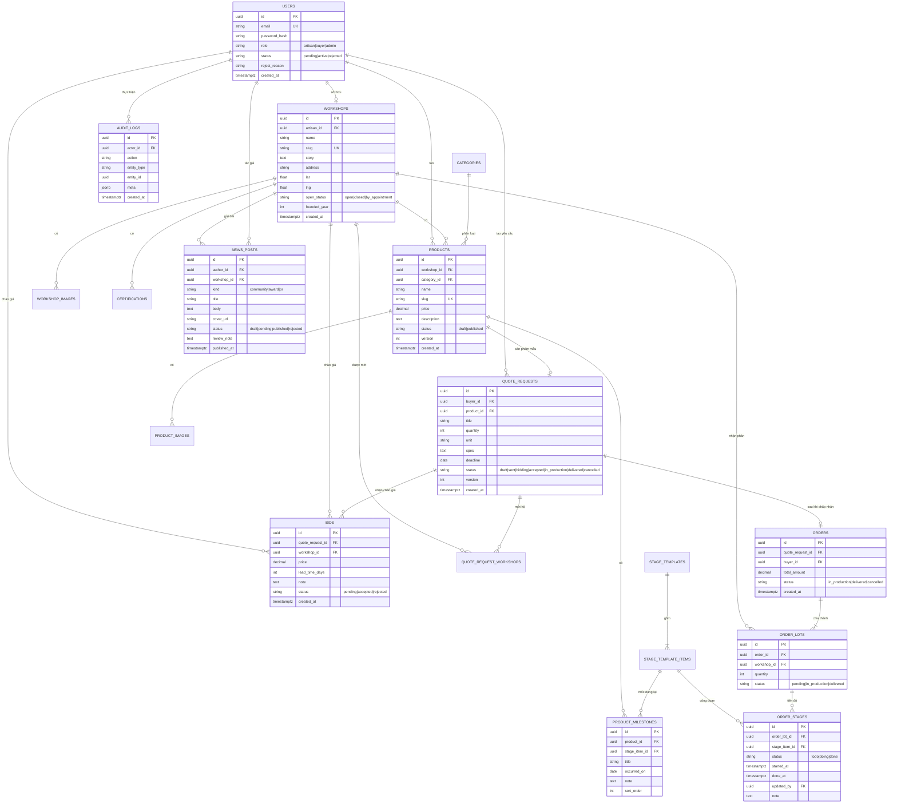

# Kiến trúc hệ thống vCraft

- **Phiên bản:** 1.0 | **Cập nhật:** 2026-11-16
- **Nguồn:** `docs/requirements.md` (V1.3), `docs/decisions/ADR-001-stack.md`, `docs/decisions/ADR-002-nginx-public-dns.md`
- **Trạng thái:** thiết kế trước khi code — mọi thay đổi lớn phải cập nhật file này

## 1. Nguyên tắc thiết kế

1. **Contract trước, code sau.** Schema DB và API contract chốt trước khi viết feature. Mọi endpoint có trong `docs/api.md` phải tồn tại trong OpenAPI do FastAPI sinh.
2. **Một nguồn sự thật cho công đoạn.** Bảng `stage_template_items` dùng chung cho cả nhật ký sản xuất (F4) và theo dõi đơn hàng (F12). Không xây 2 hệ thống giống nhau.
3. **Mọi chuyển trạng thái đi qua 1 hàm.** Không có chỗ nào `UPDATE ... SET status` trực tiếp. Lý do: cần log, cần khoá, cần kiểm tra quyền.
4. **Ảnh không đi qua Python khi hiển thị.** API nhận ảnh → resize → ghi volume → Nginx phục vụ tĩnh.
5. **Không có phụ thuộc bên ngoài lúc demo.** Không CDN, không dịch vụ trả phí, không internet là chạy được (chế độ B).
6. **Điều kiện khoá ở tầng service, không ở router.** Router gọi service, service kiểm tra state + role + khoá.

## 2. Sơ đồ tổng thể

```
┌────────────────────────── Browser (React 19 + Vite + TS) ──────────────────────────┐
│  Trang công khai   Danh mục   Bản đồ   Trang nhà xưởng   Báo giá   Admin            │
└───────────────────────────────────┬──────────────────────────────────────────────────┘
                                    │ HTTPS (Nginx)
┌───────────────────────────────────▼──────────────────────────────────────────────────┐
│ Nginx                                                                               │
│  /            → frontend/dist (SPA, try_files → index.html)                          │
│  /assets/     → cache 1y immutable                                                    │
│  /uploads/    → ảnh WebP đã resize (alias volume)                                    │
│  /api/        → proxy → uvicorn:8000  (X-Forwarded-Proto/For, rate limit login)      │
└───────────────────────────────────┬──────────────────────────────────────────────────┘
                                    │
┌───────────────────────────────────▼──────────────────────────────────────────────────┐
│ FastAPI (Uvicorn, 2 worker)                                                          │
│  routers/     auth · products · workshops · quotes · orders · admin · map · news     │
│  services/    auth_service · quote_machine · order_service · stage_service ·          │
│               image_pipeline · qr_service · news_service · report_service            │
│  core/        config (pydantic-settings) · security (jwt, argon2) · db (session)     │
└───────────┬────────────────────────────────────────────────────┬─────────────────────┘
            │ SQLAlchemy async (asyncpg)                          │ đọc/ghi file
┌───────────▼─────────────────────┐                    ┌─────────▼─────────────────────┐
│ PostgreSQL 16                   │                    │ Volume: uploads/              │
│  users · workshops · products  │                    │  products/<id>/<hash>-400.webp │
│  quotes · bids · orders · lots  │                    │  products/<id>/<hash>-1200.webp│
│  stages · news · audit_logs     │                    └───────────────────────────────┘
└─────────────────────────────────┘
```

### Phân tách module

| Module | Trách nhiệm | Không được làm |
|---|---|---|
| `routers/` | Parse request, kiểm tra token + role, gọi service, đổi response | Không chứa logic nghiệp vụ, không query DB trực tiếp |
| `services/` | Luật nghiệp vụ, transaction, khoá, log, gọi service khác | Không phụ thuộc FastAPI (`Request`, `Depends`) |
| `models/` | Bảng SQLAlchemy, quan hệ, index | Không có logic nghiệp vụ |
| `schemas/` | Pydantic: input/output, validation | Không truy vấn DB |
| `core/` | Config, security, session factory | Không chứa logic nghiệp vụ |

## 3. Cấu trúc repo

```
vcraft/
├─ backend/
│  ├─ app/
│  │  ├─ main.py                 # app, middleware, router include
│  │  ├─ core/
│  │  │  ├─ config.py            # pydantic-settings, đọc .env
│  │  │  ├─ security.py          # hash, tạo/verify JWT, dependency get_current_user
│  │  │  └─ db.py                # async engine, session factory, dependency get_session
│  │  ├─ models/                # 1 file mỗi nhóm entity
│  │  ├─ schemas/               # Pydantic input/output
│  │  ├─ routers/               # auth, workshops, products, quotes, orders, admin, map, news, public
│  │  ├─ services/              # quote_machine, order_service, stage_service, image_pipeline, qr_service, news_service
│  │  └─ seed/                  # script seed dữ liệu Bát Tràng
│  ├─ alembic/versions/
│  ├─ tests/                    # unit + integration
│  └─ pyproject.toml
├─ frontend/
│  ├─ src/
│  │  ├─ routes/                # page + route guard theo role
│  │  ├─ features/              # theo domain: products, quotes, orders, map, news, admin
│  │  ├─ components/            # ui/ (shadcn), layout/, shared/
│  │  ├─ lib/                   # api client sinh từ openapi-typescript, query client, constants
│  │  └─ hooks/
│  ├─ vite.config.ts
│  └─ package.json
├─ deploy/
│  ├─ nginx.conf
│  ├─ docker-compose.yml            # db + api + web (mode A/B)
│  ├─ docker-compose.offline.yml    # bản tối giản cho demo offline
│  └─ certs/
├─ scripts/                        # floor-guard.mjs, quality-gate.mjs
├─ docs/                           # file này + requirements + domain + api + demo-script + decisions/
├─ tasks/todo.md
├─ CONSTRAINTS.md
├─ AGENTS.md
└─ Makefile                        # make up, make seed, make test, make lint
```

## 4. Mô hình dữ liệu

### ERD



### Bảng then chốt và quy tắc

| Bảng | Quy tắc bắt buộc |
|---|---|
| `users` | `email` unique; `role` + `status` kiểm tra ở tầng service; artisan mới luôn `status='pending'` |
| `workshops` | mỗi artisan có đúng 1 workshop (`UNIQUE(artisan_id)`); `lat`/`lng` bắt buộc nếu muốn hiện ghim |
| `products` | `slug` unique toàn hệ thống để QR ổn định; `status='draft'` thì không hiện công khai; có `version` cho optimistic locking |
| `product_milestones` | `occurred_on` bắt buộc, không null; unique `(product_id, sort_order)` |
| `quote_requests` | có `version`; mọi chuyển trạng thái qua `quote_machine` |
| `bids` | unique `(quote_request_id, workshop_id)` — 1 hộ chỉ chào giá 1 lần |
| `orders` | 1 quote_request → tối đa 1 order |
| `order_lots` | unique `(order_id, workshop_id)`; tổng quantity các lot = quantity của order |
| `order_stages` | unique `(order_lot_id, stage_item_id)`; chỉ công đoạn `todo|doing` được chuyển sang `done` |
| `news_posts` | `workshop_id` null = admin đăng trực tiếp |
| `audit_logs` | **append-only**, không có UPDATE/DELETE. Ghi cho: duyệt/từ chối hộ, chuyển trạng thái quote, chuyển trạng thái order, duyệt/từ chối tin |

### Index cần có (và lý do)

| Index | Lý do |
|---|---|
| `products(workshop_id)` | lọc danh mục theo hộ — F6 |
| `products(category_id)` | lọc theo phân loại — F6 |
| `products(status)` + `products(created_at DESC)` | danh mục + sắp xếp mới nhất — F6 |
| `products(name)` — `pg_trgm` GIN | tìm kiếm tên nhanh — F6 (yêu cầu ≤1s với 200 sản phẩm) |
| `workshops(lat, lng)` | truy vấn ghim bản đồ theo vùng — F7 |
| `bids(quote_request_id)` | danh sách báo giá của 1 đơn — F8 |
| `bids(workshop_id, created_at DESC)` | "đơn của tôi" — F8 |
| `order_stages(order_lot_id)` | timeline công đoạn — F12 |
| `audit_logs(entity_type, entity_id, created_at DESC)` | tra lịch sử 1 đối tượng — F2/F8 |

## 5. Máy trạng thái

### 5.1 Quote request (F8)

```
        ┌──────────┐  gửi      ┌───────┐  có hộ báo giá   ┌─────────┐
        │  draft   │──────────▶│ sent  │──────────────────▶│ bidding │
        └──────────┘           └───────┘                   └─────────┘
              │                     │                            │
              │ hủy                 │ hủy                        │ buyer chấp nhận 1 bid
              ▼                     ▼                            ▼
        ┌─────────────────────────────────────────────────────────────┐
        │                        cancelled                          │
        └─────────────────────────────────────────────────────────────┘
                                                            ┌───────────┐
                                                            │ accepted  │
                                                            └─────┬─────┘
                                                                  │ artisan bắt đầu
                                                            ┌─────▼───────┐
                                                            │in_production│
                                                            └─────┬───────┘
                                                                  │ tất cả lot xong
                                                            ┌─────▼─────┐
                                                            │ delivered  │
                                                            └───────────┘
```

| Từ | Sang | Ai được | Điều kiện |
|---|---|---|---|
| draft | sent | buyer | đơn có ≥1 sản phẩm mẫu, số lượng > 0 |
| sent | bidding | hộ được mời | ≥1 hộ mở đơn và chào giá |
| bidding | accepted | buyer | có ≥1 bid `pending`; **chỉ 1 bid được chọn** |
| accepted | in_production | artisan nhận lot | đã tạo order + order_lot |
| in_production | delivered | artisan nhận lot | tất cả `order_stages` của lot = `done` |
| draft/sent/bidding | cancelled | buyer, admin | chưa chấp nhận bid nào |

### 5.2 News post (F11)

```
  admin đăng:      draft ─────────────────────────▶ published
  artisan gửi:    draft ──▶ pending ──▶ published
                              └──▶ rejected  (kèm review_note)
  artisan sửa bài đã published:  published ──▶ pending  (mất quyền hiển thị cho tới khi duyệt lại)
```

### 5.3 Tài khoản artisan (F2)

```
  registered ──▶ pending ──approve──▶ active
                   └───reject (kèm reject_reason)──▶ rejected
```

## 6. Luồng chính

### 6.1 Upload ảnh (F10)

```
FE: chọn N ảnh → POST /api/products/{id}/images (multipart, mỗi file 1 request)
BE:
  1. kiểm tra quyền: chủ workshop của product
  2. đọc ≤10MB (giới hạn phải khớp client_max_body_size ở Nginx = 12m)
  3. kiểm tra MIME THẬT bằng magic bytes (Pillow), không tin extension
  4. Pillow: resize → 400px (danh mục) + 1200px (chi tiết), xuất WebP, chất lượng 80
  5. tên file do server sinh: <uuid>.<w>px.webp (không dùng tên người dùng gửi)
  6. ghi vào volume uploads/products/<product_id>/
  7. lưu 2 dòng product_images (url_small, url_large, width, height, bytes)
  8. trả về danh sách ảnh
Một ảnh lỗi → trả lỗi cho ảnh đó, KHÔNG chặn các ảnh khác (tiêu chí §7 dòng 10)
```

### 6.2 QR truy xuất nguồn gốc (F5)

```
POST /api/products           → tạo product (slug unique)
  → product_qr_token = uuid ngẫu nhiên lưu DB
  → QR PNG data = f"{PUBLIC_BASE_URL}/p/{product_qr_token}"
  → trả về product + data-URL ảnh QR để FE hiển thị + tải
GET /p/{token}               → trang công khai (KHÔNG cần đăng nhập)
  → trả product + workshop + milestones theo ngày + ảnh
  → token không tồn tại → trả 404 với thông báo "không tìm thấy" (KHÔNG lỗi 500)
```

`PUBLIC_BASE_URL` là nguồn duy nhất. Xem `docs/decisions/ADR-002-nginx-public-dns.md`.

### 6.3 Báo giá (F8)

```
Buyer: POST /api/quote-requests        → draft
       POST /api/quote-requests/{id}/send → sent, tạo quote_request_workshops cho các hộ phù hợp
Hộ:    GET  /api/quote-requests?mine=1  → các đơn mình được mời
       POST /api/quote-requests/{id}/bids {price, lead_time_days, note} → bidding + bid pending
Buyer: POST /api/quote-requests/{id}/bids/{bid_id}/accept
       → TRANSACTION:
         SELECT ... FROM quote_requests WHERE id = :id FOR UPDATE
         kiểm tra status == 'bidding'
         kiểm tra bid thuộc đơn và status == 'pending'
         UPDATE bid accept → 'accepted'; các bid khác → 'rejected'
         UPDATE quote_requests → 'accepted'
         INSERT orders, INSERT order_lots (1 lot cho hộ được chọn)
         INSERT audit_logs
       → accepted
```

### 6.4 Chia đơn lớn (F9)

```
Admin: POST /api/admin/orders/{order_id}/split
  body: [{workshop_id, quantity}, ...]
  → TRANSACTION:
     SELECT order FOR UPDATE
     tổng quantity các lot hiện có + quantity mới <= order.quantity   (chặn giao vượt)
     INSERT order_lots (status 'pending')
     audit_log
  → Admin xem tiến độ tổng = sum(order_stages done) / sum(order_stages total) theo lot
```

### 6.5 Theo dõi công đoạn (F12)

```
Artisan: POST /api/order-lots/{lot_id}/stages/{stage_item_id}
  body: {status: 'doing'|'done', note?, image_url?}
  → kiểm tra lot.status == 'in_production'
  → kiểm tra công đoạn trước đã 'done'  (cấm nhảy cóc)
  → UPDATE order_stages (done_at = now nếu done)
  → nếu tất cả stage của lot đã done → lot.status = 'delivered'
  → nếu tất cả lot của order đã delivered → order.status = 'delivered'
Buyer: GET /api/orders/{id} → timeline: công đoạn nào, trạng thái, thời điểm, người cập nhật, % hoàn thành
```

### 6.6 Bản đồ (F7)

```
GET /api/map/workshops → [{workshop_id, name, lat, lng, open_status, cover_image, product_count}]
FE: react-leaflet, import dynamic ssr:false, tile OSM cache trong public/tiles/
```

## 7. Xử lý đồng thời (concurrency)

| Tình huống | Rủi ro | Cách xử lý |
|---|---|---|
| 2 người cùng chấp nhận 1 báo giá | 2 order cho 1 đơn | `SELECT ... FOR UPDATE` trên `quote_requests` trong transaction |
| 2 hộ sửa cùng 1 sản phẩm | ghi đè | `version` cột, update kèm `WHERE version = :v`, không khớp → 409 |
| Artisan đánh dấu công đoạn | nhảy cóc | kiểm tra công đoạn trước trong cùng transaction |
| Admin chia đơn 2 lần | giao vượt số lượng | `SELECT order FOR UPDATE` + kiểm tra tổng |

Quy tắc bắt buộc: **mọi thao tác đổi trạng thái nằm trong transaction** (`async with session.begin()`), và session không được dùng lại sau khi commit.

## 8. Quy tắc async (bắt buộc — nguồn lỗi số 1)

1. **Cấm lazy load.** Luôn `selectinload`/`joinedload` quan hệ cần dùng. Truy cập `obj.relation` ngoài query → `MissingGreenlet`.
2. Không gọi `session.execute` lồng nhau trong một transaction mà không `await` đúng thứ tự.
3. `run_in_threadpool` cho tác vụ CPU-bound (resize ảnh nặng, sinh QR hàng loạt) — không `await` việc nặng trong event loop.
4. Không giữ object ORM qua các `await` lâu (giữ ID thay vì object).

## 9. Biến môi trường

| Biến | Ví dụ | Bắt buộc | Ghi chú |
|---|---|---|---|
| `DATABASE_URL` | `postgresql+asyncpg://vcraft:vcraft@db:5432/vcraft` | có | |
| `SECRET_KEY` | random ≥32 byte | có | Không commit. Sinh mới cho mỗi môi trường |
| `ACCESS_TOKEN_EXPIRE_MINUTES` | `60` | có | |
| `COOKIE_SECURE` | `true` / `false` | có | `true` khi HTTPS, `false` khi demo offline HTTP |
| `PUBLIC_BASE_URL` | `https://vcraft.vn` | có | Dùng cho QR. Xem ADR-002 |
| `CORS_ORIGINS` | `https://vcraft.vn,http://localhost:5173` | có | Danh sách, phân tách bằng dấu phẩy |
| `UPLOAD_DIR` | `/srv/uploads` | có | Volume dùng chung giữa api và nginx |
| `MAX_UPLOAD_MB` | `10` | có | Phải khớp `client_max_body_size` (12m) |
| `IMAGE_SMALL_WIDTH` | `400` | có | |
| `IMAGE_LARGE_WIDTH` | `1200` | có | |
| `TILE_URL_TEMPLATE` | `https://{s}.tile.openstreetmap.org/{z}/{x}/{y}.png` | có | Có thể trỏ tới tile cache local |
| `ENV` | `dev` / `demo` / `prod` | có | |

## 10. Ngân sách hiệu năng (theo `CONSTRAINTS.md`)

| Hạng mục | Mục tiêu | Cách đạt |
|---|---|---|
| LCP | ≤ 2500ms | ảnh danh mục dùng bản 400px WebP, `loading="lazy"`, Nginx gzip + cache |
| CLS | ≤ 0.1 | khai báo kích thước ảnh (`width`/`height`), skeleton thay spinner |
| Bundle main | ≤ 250 kB gzip | lazy-load route bản đồ và route admin (`React.lazy`) |
| Danh mục 200 sản phẩm | mở < 2.5s | index DB, phân trang server-side, không tải toàn bộ danh sách |
| Upload | ≤ 10MB, resize server | Pillow + aiofiles, giới hạn ở Nginx và API |

## 11. Hạ tầng

| Thành phần | Chế độ A (public) | Chế độ B (offline) |
|---|---|---|
| Nginx | trên máy ảo, `:80/:443` | container trên laptop, `:80` |
| DNS | Cloudflare → IP máy ảo | `/etc/hosts` → 127.0.0.1 |
| TLS | Let's Encrypt hoặc Cloudflare | HTTP hoặc self-signed |
| Postgres | container, không map port | container, không map port |
| Uvicorn | systemd hoặc compose, `--workers 2` | compose |
| Frontend | build tĩnh → Nginx | build tĩnh → Nginx |
| `PUBLIC_BASE_URL` | `https://vcraft.vn` | `http://<IP-LAN>` |

Chi tiết cấu hình: `docs/decisions/ADR-002-nginx-public-dns.md`.

## 12. Câu hỏi còn mở

| Câu hỏi | Chặn gì | Chốt khi |
|---|---|---|
| Tên miền chính thức | `server_name`, DNS, `PUBLIC_BASE_URL`, nội dung QR | Tuần 1 |
| Máy ảo có IP công khai? | certbot hay Cloudflare Tunnel | Trước khi cấu hình |
| Hộ "phù hợp" được chọn bằng tiêu chí nào? | Luồng gửi đơn (F8) — theo phân loại sản phẩm? theo mở cửa? theo đánh giá? | Trước khi code F8 |
| Công đoạn mặc định cho từng nghề | seed `stage_template_items` | Trước khi code F12 |
| Có giới hạn số ảnh/sản phẩm không? | Validate | Khi code F10 |

## 13. Lịch sử

| Ngày | Thay đổi | Người |
|---|---|---|
| 2026-11-16 | Phiên bản 1.0: sơ đồ tổng thể, ERD, máy trạng thái, 6 luồng chính, quy tắc concurrency, biến môi trường | Nhóm |
